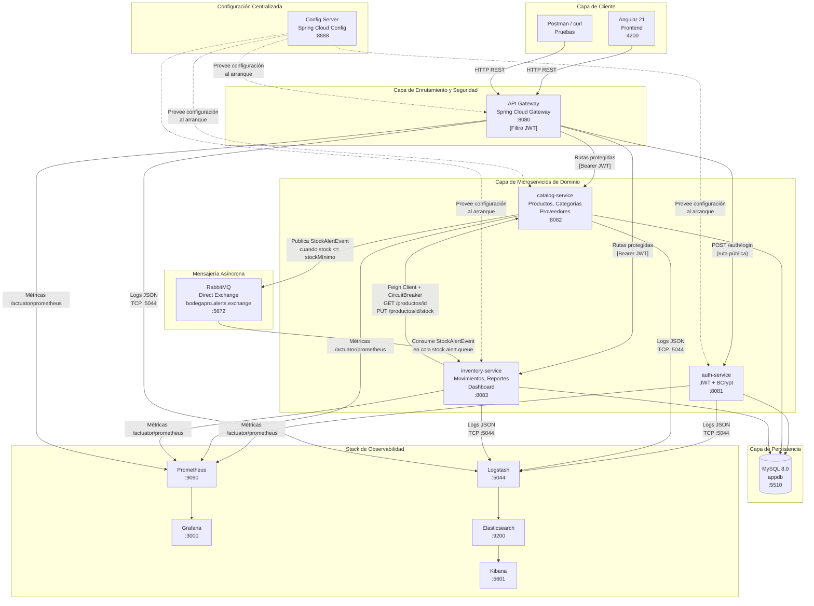
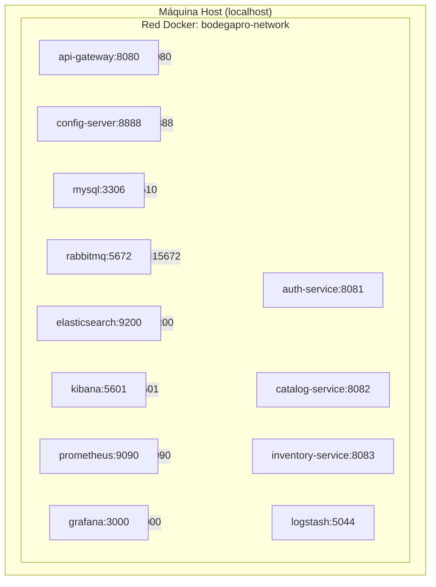
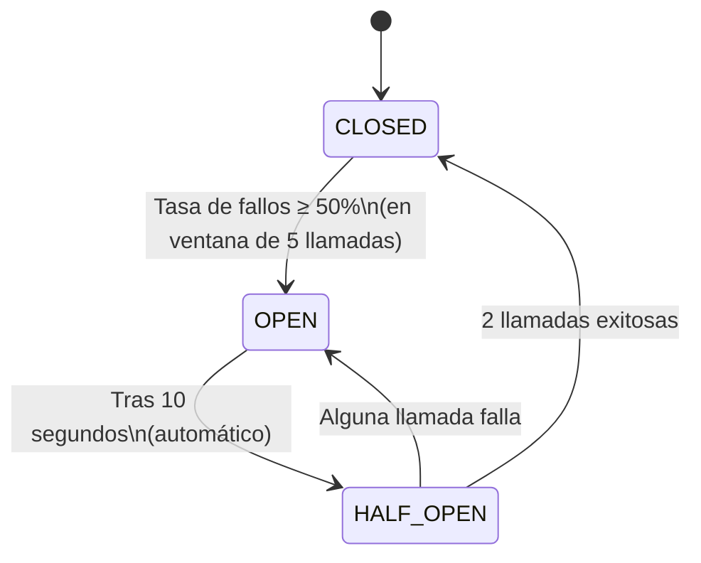
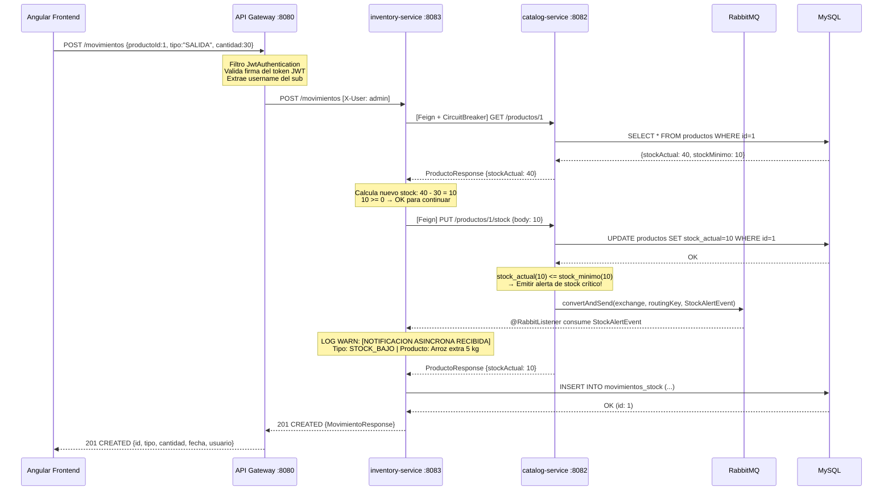

# BodegaPro — Informe Tecnológico

**Institución:** CIBERTEC | **Curso:** Arquitectura de Software — Sexto Ciclo  
**Proyecto:** Sistema de Gestión de Inventario para Bodegas Peruanas (BodegaPro)  
**Tipo de Entrega:** Informe Académico de Arquitectura y Despliegue  
**Fecha:** Octubre 2026

---

## Tabla de Contenidos

1. [Resumen Ejecutivo](#1-resumen-ejecutivo)
2. [Arquitectura del Sistema](#2-arquitectura-del-sistema)
3. [Estructura de Microservicios](#3-estructura-de-microservicios)
4. [Stack Tecnológico y Justificación por Unidad](#4-stack-tecnológico-y-justificación-por-unidad)
5. [Reglas de Negocio Preservadas](#5-reglas-de-negocio-preservadas)
6. [Flujo de una Transacción Completa](#6-flujo-de-una-transacción-completa)
7. [Conclusión](#7-conclusión)

---

## 1. Resumen Ejecutivo

**BodegaPro** es un sistema de gestión de inventario diseñado para pequeñas y medianas bodegas del mercado peruano. El proyecto nació como una aplicación monolítica en Spring Boot, y fue migrado íntegramente a una **arquitectura de microservicios orientada a eventos**, aplicando los principios y tecnologías estudiados en las tres unidades del curso de Arquitectura de Software.

### Objetivo de la Migración

| Dimensión | Monolito Original | Nueva Arquitectura de Microservicios |
|---|---|---|
| **Escalabilidad** | Escalado total de la aplicación | Escalado independiente por dominio funcional |
| **Despliegue** | Un único artefacto frágil | Contenedores Docker independientes + K8s |
| **Resiliencia** | Fallo único apaga todo el sistema | Circuit Breaker aísla los fallos por servicio |
| **Comunicación** | Llamadas a métodos internos | REST síncrono (Feign) + eventos asíncronos (RabbitMQ) |
| **Monitoreo** | Logs en consola local | Stack ELK centralizado + Prometheus + Grafana |
| **Seguridad** | Autenticación acoplada al negocio | Gateway JWT centralizado desacoplado |
| **Configuración** | `application.properties` duplicadas | Spring Cloud Config Server centralizado |

El sistema resultante implementa un total de **5 microservicios Spring Boot**, una capa de **API Gateway** con autenticación JWT centralizada, mensajería asíncrona con **RabbitMQ**, observabilidad completa con el **stack ELK + Prometheus + Grafana**, y manifiestos de **Kubernetes** para orquestación en producción.

---

## 2. Arquitectura del Sistema

### 2.1 Diagrama General de Arquitectura



### 2.2 Topología de Despliegue Docker

Todos los servicios se comunican dentro de la red Docker interna `bodegapro-network` (bridge). Solo se exponen al host los puertos necesarios para desarrollo y administración.



### 2.3 Patrón de Comunicación: Síncrono vs. Asíncrono

El sistema implementa dos patrones de comunicación complementarios:

| Aspecto | Comunicación Síncrona (REST/Feign) | Comunicación Asíncrona (RabbitMQ) |
|---|---|---|
| **Cuándo se usa** | Cuando el resultado es necesario de inmediato | Cuando la acción puede procesarse posteriormente |
| **Ejemplo en BodegaPro** | `inventory-service` consulta y actualiza el stock en `catalog-service` al registrar un movimiento | `catalog-service` notifica a `inventory-service` cuando el stock de un producto cae al nivel crítico |
| **Tecnología** | OpenFeign + Resilience4j | RabbitMQ (Direct Exchange) |
| **Tolerancia a fallos** | Circuit Breaker + Retry automático | Desacoplamiento total; la cola persiste el mensaje |

---

## 3. Estructura de Microservicios

El backend está organizado como un **Gradle Multi-Project** bajo el directorio `backend/`, con los siguientes módulos:

### 3.1 `common-dto` — Biblioteca de Contratos Compartidos

**Tipo:** Librería JAR (no es un servicio Spring Boot)  
**Responsabilidad:** Define los objetos de transferencia de datos (DTOs) y eventos compartidos entre todos los microservicios, garantizando un contrato único.

| Clase | Tipo | Descripción |
|---|---|---|
| `LoginRequest` / `LoginResponse` | Record DTO | Petición y respuesta de autenticación |
| `ProductoRequest` / `ProductoResponse` | Record DTO | Datos de un producto del catálogo |
| `MovimientoRequest` / `MovimientoResponse` | Record DTO | Registro de entrada/salida de stock |
| `CategoriaRequest/Response` | Record DTO | Datos de categorías de producto |
| `ProveedorRequest/Response` | Record DTO | Datos de proveedores |
| `DashboardResponse` | Record DTO | Agregado del resumen del dashboard |
| `StockAlertEvent` | Clase de Evento | Evento publicado en RabbitMQ cuando el stock es crítico |
| `TipoMovimiento` | Enum | `ENTRADA` / `SALIDA` |

### 3.2 `config-server` — Servidor de Configuración Centralizada

**Puerto:** `8888` | **Perfil:** `native` (configuraciones en classpath)  
**Responsabilidad:** Actúa como fuente única de verdad para la configuración de todos los servicios. Los microservicios la cargan al arranque mediante `spring.config.import`.

**Archivos de configuración servidos:**
- `classpath:/configurations/application.yml` → Configuración compartida (Actuator, métricas)
- `classpath:/configurations/inventory-service.yml` → Circuit Breaker y Retry de Resilience4j

### 3.3 `api-gateway` — Puerta de Enlace y Seguridad

**Puerto:** `8080` | **Framework:** Spring Cloud Gateway (reactivo con Netty)  
**Responsabilidad:** Punto de entrada único para todos los clientes. Centraliza la autenticación JWT, el enrutamiento dinámico y el control de acceso.

**Rutas configuradas:**

| Ruta | Destino | Filtro |
|---|---|---|
| `/auth/**` | `auth-service:8081` | Pública (sin autenticación) |
| `/actuator/**` | `api-gateway:8080` | Pública |
| `/productos/**` | `catalog-service:8082` | `JwtAuthentication` |
| `/categorias/**` | `catalog-service:8082` | `JwtAuthentication` |
| `/proveedores/**` | `catalog-service:8082` | `JwtAuthentication` |
| `/movimientos/**` | `inventory-service:8083` | `JwtAuthentication` |
| `/dashboard/**` | `inventory-service:8083` | `JwtAuthentication` |
| `/reportes/**` | `inventory-service:8083` | `JwtAuthentication` |

### 3.4 `auth-service` — Autenticación y Gestión de Identidad

**Puerto:** `8081`  
**Responsabilidad:** Única fuente de verdad de usuarios del sistema. Gestiona el registro, el login y la emisión de tokens JWT firmados con HMAC-SHA384.

**Componentes clave:**
- `AuthController`: Expone `POST /auth/login` y `POST /auth/register`
- `AuthService`: Valida credenciales con `BCryptPasswordEncoder` y delega la generación del token
- `JwtService`: Firma y verifica tokens JWT (clave secreta configurable, expiración: 120 min)
- `DataInitializer`: Precarga los usuarios `admin` (ADMIN) y `vendedor` (VENDEDOR) al arranque si no existen

### 3.5 `catalog-service` — Gestión del Catálogo de Productos

**Puerto:** `8082`  
**Responsabilidad:** Dominio de negocio para productos, categorías y proveedores. Es el único propietario de los datos de stock de los productos.

**Componentes clave:**
- `ProductoController`: CRUD completo de productos + endpoint `PUT /productos/{id}/stock`
- `CategoriaController` / `ProveedorController`: CRUD de catálogos auxiliares
- `ProductoService`: Lógica de negocio incluyendo validación de precios y detección de stock mínimo
- `AlertProducerService`: Publica el evento `StockAlertEvent` al exchange de RabbitMQ cuando `stockActual <= stockMinimo`
- `RabbitMQConfig`: Define el `DirectExchange` (`bodegapro.alerts.exchange`) y el binding con `bodegapro.alerts.stock`

### 3.6 `inventory-service` — Movimientos de Stock y Reportes

**Puerto:** `8083`  
**Responsabilidad:** Registra los movimientos de inventario (entradas y salidas) y genera reportes exportables. Se comunica síncronamente con `catalog-service` mediante Feign para validar y actualizar el stock.

**Componentes clave:**
- `MovimientoController`: `GET /movimientos` y `POST /movimientos`
- `MovimientoService`: Orquesta el registro del movimiento, validación de stock suficiente, actualización en `catalog-service` vía Feign y persistencia local
- `CatalogClient` (Feign): Interface declarativa que apunta a `${catalog-service.url}`
- `CatalogServiceProxy`: Aplica el patrón decorador con `@CircuitBreaker` y `@Retry` de Resilience4j
- `StockAlertConsumerService`: Listener `@RabbitListener` que consume `StockAlertEvent` de la cola `bodegapro.stock.alert.queue` y registra la alerta en los logs
- `DashboardController` / `DashboardService`: Agrega datos de `catalog-service` vía Feign para el panel de control
- `ReporteController` / `ReporteService`: Genera reportes filtrados en formato **Excel** (.xlsx con Apache POI) y **PDF** (.pdf con Apache PDFBox)

---

## 4. Stack Tecnológico y Justificación por Unidad

### Unidad 1 — Arquitectura y Servicios

#### Spring Boot 3.2.5

**Justificación:** Framework estándar de la industria para la construcción de microservicios Java. Proporciona autoconfiguración, un servidor embebido (Tomcat/Netty) y un ecosistema maduro de integraciones. La versión 3.x soporta nativemente Java 17 y las especificaciones Jakarta EE 10.

#### Spring Cloud Config (Config Server)

**Justificación:** En una arquitectura de microservicios, la gestión de configuración distribuida es crítica. El uso del Config Server permite:
- Modificar propiedades (como el Circuit Breaker) sin recompilar ni redesplegar los servicios.
- Mantener un único punto de verdad para configuraciones transversales (Actuator, métricas).
- El perfil `native` permite usar el classpath sin necesidad de un repositorio Git externo en el entorno de desarrollo.

#### OpenFeign (Comunicación Síncrona)

**Justificación:** El `inventory-service` necesita conocer el stock actual y actualizarlo en el `catalog-service` de forma **síncrona** al registrar un movimiento (ya que el resultado afecta directamente la respuesta al cliente). Feign simplifica esta integración HTTP al permitir definir interfaces declarativas:

```java
@FeignClient(name = "catalog-service", url = "${catalog-service.url:http://localhost:8082}")
public interface CatalogClient {
    @GetMapping("/productos/{id}")
    ProductoResponse getProductoById(@PathVariable("id") Long id);

    @PutMapping("/productos/{id}/stock")
    ProductoResponse updateStock(@PathVariable("id") Long id, @RequestBody Integer nuevoStock);
}
```

#### RabbitMQ (Mensajería Asíncrona — Eventos de Dominio)

**Justificación:** La notificación de stock crítico es un **evento de dominio** que no requiere respuesta inmediata. El uso de RabbitMQ desacopla al `catalog-service` (productor) del `inventory-service` (consumidor), garantizando que la alerta sea procesada aunque el consumidor esté temporalmente caído (la cola persiste el mensaje).

**Topología implementada:**

```
catalog-service
      │
      │ convertAndSend(exchange, routingKey, event)
      ▼
bodegapro.alerts.exchange  (DirectExchange)
      │
      │ binding: "bodegapro.alerts.stock"
      ▼
bodegapro.stock.alert.queue  (Queue durable)
      │
      │ @RabbitListener
      ▼
inventory-service → StockAlertConsumerService → LOG de alerta
```

**Gradle Multi-Project Build:** La estructura del backend como un proyecto Gradle multi-módulo permite que `common-dto` sea compilado una sola vez y referenciado como dependencia por todos los microservicios, evitando la duplicación de código.

---

### Unidad 2 — Seguridad y Resiliencia

#### Spring Cloud Gateway + JWT Centralizado

**Justificación:** El API Gateway implementa el patrón **Backend for Frontend (BFF)** y la seguridad mediante un filtro `JwtAuthentication` personalizado. Este diseño tiene varias ventajas críticas:

1. **Seguridad centralizada:** Los microservicios de dominio (`catalog-service`, `inventory-service`) **no** implementan ninguna lógica de seguridad. Confían en que el Gateway ya validó la identidad del solicitante, eliminando la duplicación de código de seguridad en cada servicio.
2. **Propagación del usuario:** El Gateway extrae el campo `sub` (username) del token JWT y lo propaga como encabezado `X-User` a los servicios de dominio. El `inventory-service` lo usa para registrar el usuario que ejecutó cada movimiento.
3. **Escalabilidad:** Al ser un filtro de red, puede escalar independientemente de la lógica de negocio.

**Algoritmo de firma JWT:** `HMAC-SHA384` (HS384) — firmado con una clave secreta de al menos 32 caracteres configurada en `app.jwt.secret`.

**Protección de contraseñas:** `BCryptPasswordEncoder` (factor de coste 10) en el `auth-service`.

**CORS configurado** en el `auth-service` para permitir peticiones desde `http://localhost:4200`.

#### Resilience4j — Circuit Breaker y Retry (Tolerancia a Fallos)

**Justificación:** La comunicación síncrona entre `inventory-service` y `catalog-service` introduce una dependencia de disponibilidad. Si `catalog-service` falla, sin un mecanismo de resiliencia, el `inventory-service` también fallaría en cascada. Resilience4j resuelve esto con dos patrones:

**Circuit Breaker (`catalogServiceCB`)** — Configuración servida por el Config Server:
```yaml
resilience4j:
  circuitbreaker:
    instances:
      catalogServiceCB:
        sliding-window-type: COUNT_BASED
        sliding-window-size: 5          # Evalúa las últimas 5 llamadas
        minimum-number-of-calls: 3      # Mínimo 3 llamadas para evaluar
        failure-rate-threshold: 50      # Abre el circuito si el 50% fallan
        wait-duration-in-open-state: 10000ms  # Permanece abierto 10 segundos
        permitted-number-of-calls-in-half-open-state: 2
        automatic-transition-from-open-to-half-open-enabled: true
```

**Comportamiento del Circuit Breaker:**



**Retry (`catalogServiceRetry`):**
```yaml
resilience4j:
  retry:
    instances:
      catalogServiceRetry:
        max-attempts: 3               # Hasta 3 intentos
        wait-duration: 1000ms         # Espera 1 segundo entre intentos
        enable-exponential-backoff: true
        exponential-backoff-multiplier: 2  # Esperas: 1s, 2s, 4s
```

**Métodos Fallback:** Cuando el circuito está abierto (o los 3 reintentos fallan), el `CatalogServiceProxy` activa métodos fallback que devuelven respuestas controladas (listas vacías o excepción con `503 SERVICE_UNAVAILABLE` en operaciones críticas como `updateStock`), en lugar de propagar el error de red al cliente final.

---

### Unidad 3 — Despliegue y Observabilidad

#### Docker y Docker Compose

**Justificación:** Docker permite empaquetar cada microservicio con todas sus dependencias en una imagen portátil y reproducible. El `docker-compose.yml` define la infraestructura completa como **código (IaC)**, garantizando que cualquier desarrollador pueda levantar el entorno idéntico en su máquina con un solo comando.

**Dockerfile estándar de los microservicios:**
```dockerfile
FROM eclipse-temurin:17-jre-alpine
WORKDIR /app
COPY build/libs/*.jar app.jar
EXPOSE 8081
ENTRYPOINT ["java", "-jar", "app.jar"]
```

La imagen base `eclipse-temurin:17-jre-alpine` es mínima (~190 MB) comparada con una imagen JDK completa, optimizando el tamaño del contenedor.

#### Kubernetes (K8s) — Orquestación en Producción

**Justificación:** Docker Compose es adecuado para desarrollo local, pero no está diseñado para producción. Kubernetes aporta:
- **Auto-healing:** Reinicia automáticamente pods fallidos.
- **Escalado horizontal:** `kubectl scale deployment catalog-service --replicas=3`
- **Gestión declarativa:** El estado deseado del clúster está definido en archivos YAML versionables.
- **Service Discovery nativo:** Los servicios se comunican por nombre DNS interno dentro del namespace.

**Recursos generados en `k8s/`:**

| Recurso | Descripción |
|---|---|
| `Namespace` | Aislamiento lógico `bodegapro` |
| `Secret` | Credenciales sensibles (BD, JWT, RabbitMQ) codificadas en `stringData` |
| `ConfigMap` | Variables de entorno no sensibles (URLs internas, perfiles) |
| `PersistentVolumeClaim` | Almacenamiento persistente de 1Gi para MySQL |
| `Deployment` (×7) | Especificación de réplicas, imagen, variables de entorno y probes para cada servicio |
| `Service ClusterIP` (×6) | Comunicación interna entre pods por nombre DNS |
| `Service LoadBalancer` (×1) | Exposición del `api-gateway` al exterior en el puerto `8080` |

**Probes de salud** configuradas en todos los Deployments:
- `readinessProbe`: HTTP GET `/actuator/health` — el pod no recibe tráfico hasta que el servicio esté listo.
- `livenessProbe`: HTTP GET `/actuator/health` — Kubernetes reinicia el pod si el servicio se congela.

#### Micrometer + Spring Boot Actuator (Métricas)

**Justificación:** Actuator expone el endpoint `/actuator/prometheus` con métricas en el formato estándar de la industria (OpenMetrics). Micrometer actúa como fachada de métricas agnóstica al backend, permitiendo cambiar el sistema de recolección sin modificar el código de la aplicación.

Métricas recolectadas automáticamente:
- **JVM:** Uso de heap, GC, hilos activos (`jvm_memory_used_bytes`, `jvm_gc_pause_seconds`)
- **HTTP:** Conteo de peticiones, latencias por endpoint (`http_server_requests_seconds`)
- **HikariCP:** Pool de conexiones a la base de datos
- **RabbitMQ:** Mensajes publicados y consumidos
- **Resilience4j:** Estado del Circuit Breaker y tasa de fallos

Todos los servicios envían métricas con el tag `application: ${spring.application.name}` para identificación en Prometheus y Grafana.

#### Prometheus

**Justificación:** Motor de recolección y almacenamiento de métricas de series temporales. Realiza el scraping activo de los endpoints `/actuator/prometheus` de cada microservicio cada 15 segundos. Permite consultas con el lenguaje PromQL.

Configuración de targets en `docker/prometheus/prometheus.yml`:
```yaml
scrape_configs:
  - job_name: 'api-gateway'
    metrics_path: '/actuator/prometheus'
    static_configs:
      - targets: ['api-gateway:8080']
  - job_name: 'catalog-service'
    metrics_path: '/actuator/prometheus'
    static_configs:
      - targets: ['catalog-service:8082']
  # ... (5 microservicios en total)
```

#### Grafana

**Justificación:** Plataforma de visualización que se conecta a Prometheus como datasource. Permite crear dashboards interactivos para monitorear en tiempo real la salud de la plataforma: uso de CPU y memoria por servicio, tasa de peticiones HTTP, latencias de percentil P95/P99, y estado del Circuit Breaker.

#### Stack ELK (Elasticsearch + Logstash + Kibana)

**Justificación:** En una arquitectura de microservicios, los logs distribuidos son imposibles de analizar sin una plataforma centralizada. El stack ELK resuelve esto:

| Componente | Rol en BodegaPro |
|---|---|
| **Logback (logstash-logback-encoder)** | Formatea los logs de cada microservicio en JSON estructurado y los envía por TCP al puerto `5044` de Logstash |
| **Logstash** | Recibe los eventos JSON, les añade el índice de destino (`bodegapro-logs-YYYY.MM.DD`) y los envía a Elasticsearch |
| **Elasticsearch** | Indexa y almacena los logs estructurados, permitiendo búsquedas por campo (servicio, severidad, mensaje, timestamp) |
| **Kibana** | Interfaz web para explorar los logs en tiempo real, crear visualizaciones y alertas |

Configuración del `logstash.conf`:
```
input {
  tcp { port => 5044; codec => json_lines }
}
filter {
  mutate { add_field => { "[@metadata][target_index]" => "bodegapro-logs-%{+YYYY.MM.dd}" } }
}
output {
  elasticsearch { hosts => ["http://elasticsearch:9200"]; index => "%{[@metadata][target_index]}" }
  stdout { codec => rubydebug }
}
```

---

## 5. Reglas de Negocio Preservadas

La migración a microservicios preservó íntegramente todas las reglas de negocio del sistema original. Las más críticas son:

### 5.1 Stock No Puede Ser Negativo

**Implementación:** En `MovimientoService.registrarMovimiento()`:
```java
int nuevoStock = request.tipo() == TipoMovimiento.ENTRADA
        ? stockActual + request.cantidad()
        : stockActual - request.cantidad();

if (nuevoStock < 0) {
    throw new ResponseStatusException(HttpStatus.CONFLICT,
            "Stock insuficiente. Disponible: " + stockActual + ", solicitado: " + request.cantidad());
}
```
**Garantía:** Una salida que llevaría el stock a negativo retorna HTTP `409 CONFLICT` antes de persistir cualquier dato.

### 5.2 Alerta Automática de Stock Crítico

**Implementación:** En `ProductoService.updateStock()`:
```java
if (alertProducerService != null && guardado.getStockActual() <= guardado.getStockMinimo()) {
    alertProducerService.emitStockAlert(StockAlertEvent.builder()
            .tipoAlerta("STOCK_BAJO")
            .productoId(guardado.getId())
            // ...
            .build());
}
```
**Garantía:** Cada vez que el stock se actualiza y queda en o por debajo del mínimo configurado, se emite un evento asíncrono a RabbitMQ que es consumido por el `inventory-service`.

### 5.3 Precio de Venta No Puede Ser Menor al Precio de Compra

**Implementación:** En `ProductoService.validarPrecios()`:
```java
if (request.precioVenta().compareTo(request.precioCompra()) < 0) {
    throw new ResponseStatusException(HttpStatus.BAD_REQUEST,
            "El precio de venta no puede ser menor al precio de compra");
}
```

### 5.4 Código de Producto Único

**Implementación:** `ProductoRepository.existsByCodigo(codigo)` verificado antes de crear y al actualizar, retornando HTTP `409 CONFLICT` en caso de duplicado.

### 5.5 Roles de Usuario (ADMIN / VENDEDOR)

Los dos roles del sistema son:
- **ADMIN:** Puede ejecutar todas las operaciones (crear/editar/eliminar productos, proveedores, categorías, registrar movimientos).
- **VENDEDOR:** Acceso limitado a consultas y registro de movimientos de salida.

El rol se incluye en el payload del token JWT y el Gateway lo propaga a los servicios de dominio.

### 5.6 Integridad Transaccional

Los métodos de escritura críticos están anotados con `@Transactional` para garantizar que la operación completa (registro del movimiento + actualización del stock) sea atómica. Si la llamada Feign a `catalog-service` falla después de guardar el movimiento local, la excepción hace rollback de la transacción.

### 5.7 Trazabilidad de Movimientos

Cada movimiento de stock persiste el campo `usuario` (propagado por el Gateway desde el token JWT como el encabezado `X-User`), garantizando auditoría completa de quién realizó cada operación.

---

## 6. Flujo de una Transacción Completa

El siguiente diagrama ilustra el flujo completo de un movimiento de salida que activa una alerta de stock:



---

## 7. Conclusión

La migración de BodegaPro de un monolito a una arquitectura de microservicios orientada a eventos ha demostrado ser técnicamente exitosa, habiendo aplicado de forma cohesionada las tres unidades del curso.

### Beneficios Obtenidos

| Beneficio | Evidencia Técnica |
|---|---|
| **Escalabilidad independiente** | Cada microservicio tiene su propio `Deployment` en Kubernetes con réplicas configurables de forma independiente |
| **Tolerancia a fallos** | El Circuit Breaker de Resilience4j aísla los fallos entre `inventory-service` y `catalog-service`; los fallbacks garantizan respuestas controladas |
| **Desacoplamiento** | Las alertas de stock viajan por RabbitMQ sin que `catalog-service` necesite saber quién las va a procesar |
| **Configuración dinámica** | Los parámetros del Circuit Breaker y otras propiedades pueden actualizarse en el Config Server sin recompilar |
| **Seguridad centralizada** | La validación JWT en el Gateway evita duplicar lógica de seguridad en cada microservicio |
| **Observabilidad total** | 632+ eventos de log indexados en Elasticsearch, 5 targets activos en estado `UP` en Prometheus tras la sesión de prueba |
| **Portabilidad** | La infraestructura completa se levanta con `docker compose up -d --build` y se despliega en K8s con `kubectl apply -f k8s/` |
| **Contratos claros** | El módulo `common-dto` garantiza que todos los servicios hablen el mismo "idioma" de datos |

### Métricas de la Prueba Integral End-to-End

La validación integral realizada confirmó el funcionamiento de todo el flujo de negocio:

- ✅ `POST /auth/login` → Token JWT generado con rol `ADMIN`
- ✅ `GET /productos` → 8 productos retornados a través del Gateway con JWT validado
- ✅ `POST /movimientos` → Movimiento registrado, Feign actualizó el stock en `catalog-service` (40 → 35)
- ✅ `StockAlertEvent` emitido por `catalog-service` y consumido por `inventory-service` vía RabbitMQ en < 300ms
- ✅ `GET /actuator/prometheus` → Métricas de JVM expuestas; 5/5 targets en Prometheus con estado `health: up`
- ✅ Elasticsearch indexó 632 documentos de log en el índice `bodegapro-logs-2026.10.15`

Esta arquitectura sienta las bases para que BodegaPro pueda crecer como plataforma SaaS, incorporar nuevos dominios de negocio (facturación, logística, reportería avanzada) como microservicios adicionales sin afectar los existentes, y desplegarse en un proveedor de nube (AWS EKS, GCP GKE, Azure AKS) con mínimas modificaciones a los manifiestos de Kubernetes.
